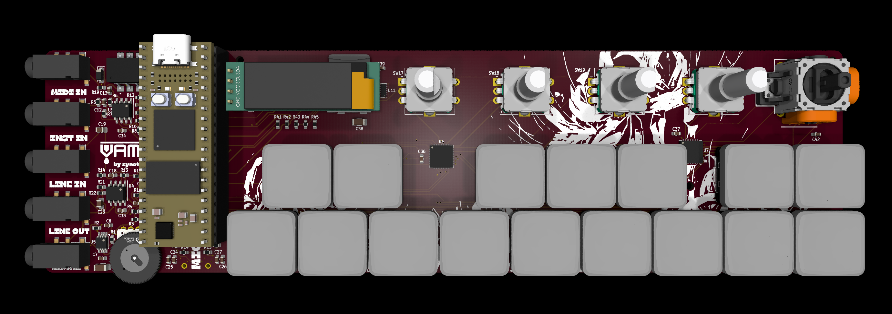
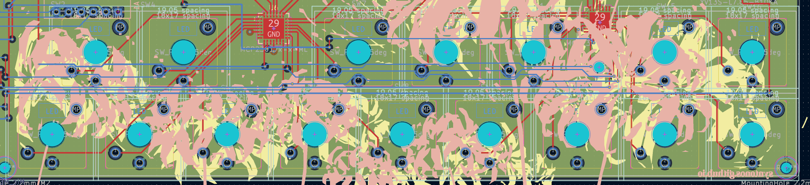
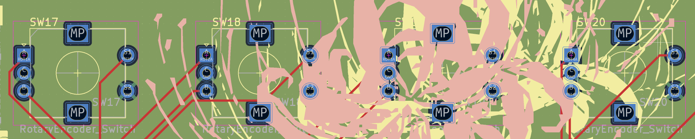
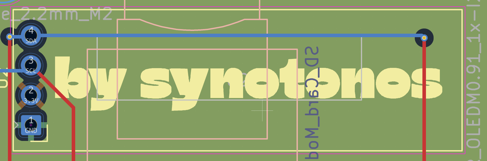
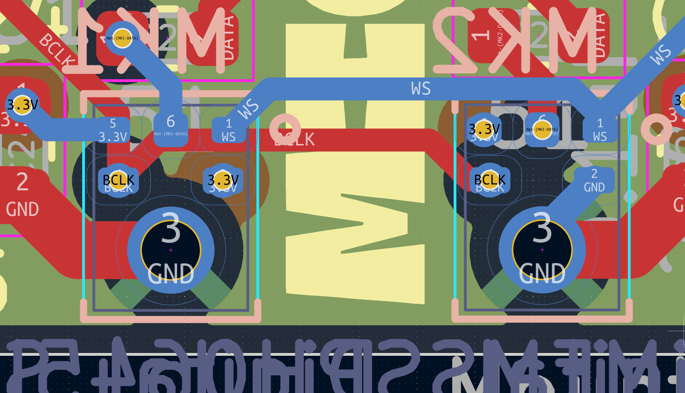
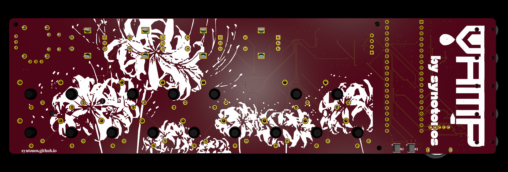
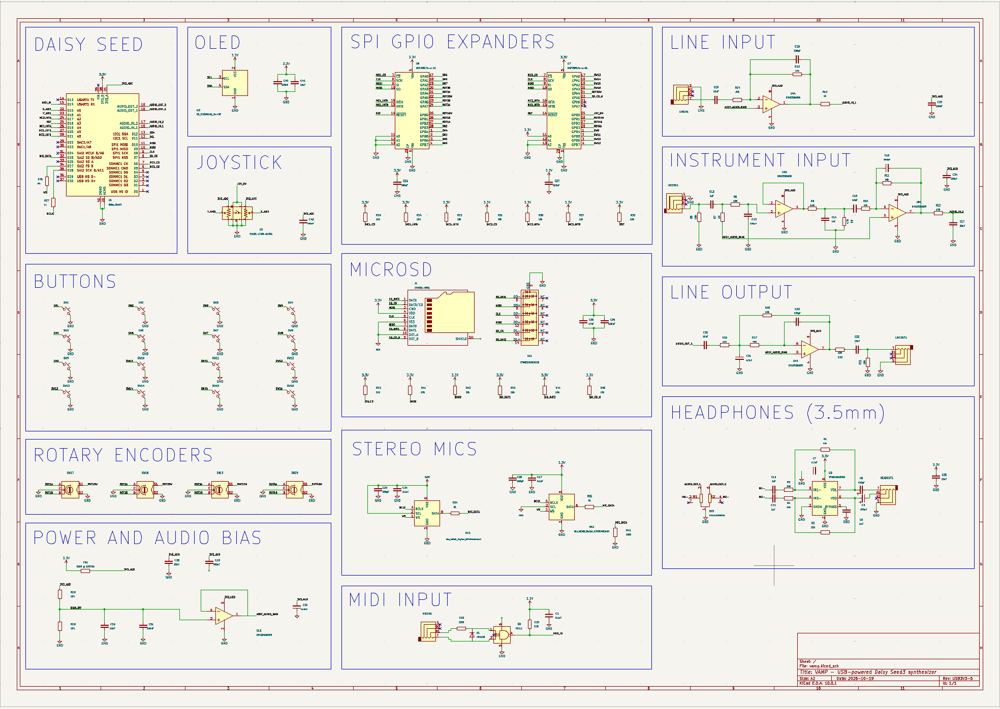
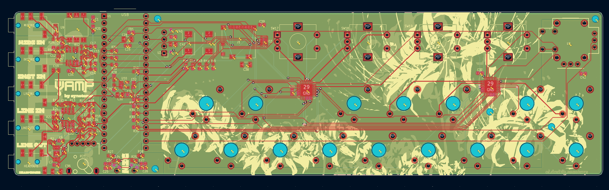
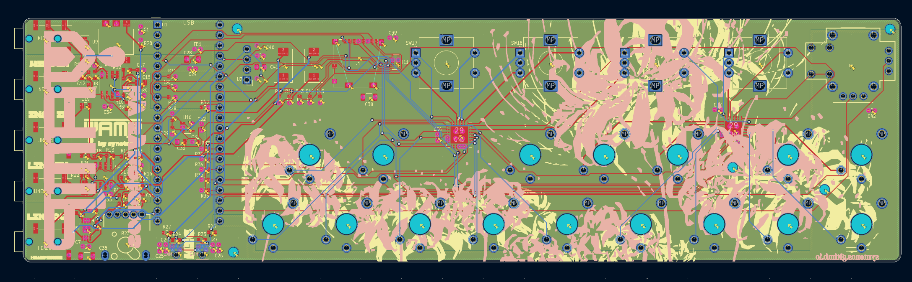

# VAMP | by synotonos

**Sample, synthesize, VAMP.** 

An experimental, intuitive sampler synth, based with Daisy Seed 3. Pocket sized and equipped with an onboard sampling mic.

## About
A VAMP is a repeated four-chord progression. A vampire is a creature of myth that drinks blood, probably among other things. 

**VAMP by syntonos** is a play on both of those definitions. Take the lifeblood of a sound, then build a creature of your own with it. Built for field sampling and on-the-go chord construction, with an onboard microphone and headphone port.

At its most basic, I'd like it to be able to take a sample and pitch shift it to match each of the octave's keys + modulation with sampling and playback with the knobs & joystick (time dilation, pitch, reverb, distortion, sampling bitrate). There would also be a looper. (I'm coding this already, it should be done by the time the build is approved, but I do need the physical sampler to test the code.) At its best (might take a while for me to research the music theory and then code), I'd like for it to be able to recognize chords based on keys played and then have the joystick be able to modify it (inversions, substitutions, etc). It would be an interesting way to apply polyphony and sampling, and it would make VAMP a unique, experimental chord builder.

This whole set of synths is mostly because I do want to make music, and I want an instrument that works for me. I'm also very interested in digital signal processing, and this teaches both. Inspired by a ton of samplers currenly out (AKAI MPC Sample, CHOMPI, PO33-KO). I wanted this to be portable and pocketable, and this technically is if you have big pockets. (Also working on a tiny little portable battery to accompany this, it currently can be used attached to any USB-C 5V 1A source).

## Features
- 8-note keyboard + 4 layers to toggle through.
- 4 rotary encoders + an analog joystick for sound modulation. 
- 0.91" OLED display.
- Five 3.5mm TRS ports: MIDI IN, INSTRUMENT IN, LINE IN, LINE OUT, USB-C Power + Data.
- 3.5mm headphone jack. 
- Onboard omnidirectional stereo microphone with additional LINE IN options.
- Up to ten minutes of sampling time with the Daisy Seed. 
- USB-C 5V 1A power. 

## Assembly Instructions + Flashing Firmware
### Soldering
Solder in the:
- 16x Keyswitches
    - Throughhole. Line up the pins with SW1 - 16, then solder the pins into place.

- 4x Rotary Encoders EC11 Half 15mm
    - Throughhole. Align the pins, secure the encoder through the mounting pins, and solder the pins into place.

- 1x 0.91" OLED Display
    - Make sure the pins match the labels on the silkscreen or the PCB (Top to Bottom: SDA SCK 3V3 GND). Solder the pins into place.

- 2x MEMS Microphones 
    - Located on the back of the PCB, right below the Daisy Seed 3. Tin each of the exposed pads. Make sure your connections do not short. Then press the SMT mic into the pads. Again, make sure none of your connections short. Use a hot plate or a reflow oven as needed.

- OPTIONAL 1x SD Card Module
    - Located on the bottom side of the PCB, below the OLED display module. Align the module so that it's facing up, then insert the pins (check that the nets are correct) then solder them in. 

## PCB
### 3D Models

### Schematic

### PCB Layout

### Firmware
Follow the Daisy Seed's instructions for flashing firmware [Electro Smith](https://electro-smith.github.io/libDaisy/md_doc_2md_2__a7___getting-_started-_daisy-_bootloader.html). Firmware found in the folder firmware. FLASH THROUGH THE DAISY BOOTLOADER. THIS REQUIRES THE RAM.

## BOM
- 1x PCB + PCBA (topside)
- 1x Daisy Seed 3
- 1x 0.91" OLED Display Module
- 4x Rotary Encoders EC11 15mm Half
- 4x Rotary Encoder Caps (White for default)
- 16x Kaihl Choc V2 Low Profile Switches (Deep Sea Whale for default)
- 16x 3D Printed Keycaps (Choc Spacing)

## BOM Expanded
- 1x PCB + PCBA (topside)
    - $189.61 + tariffs ([JLCPCB](https://jlcpcb.com/))
- 1x Daisy Seed 3
    - $29.99 + shipping [ElectroSmith](https://daisy.audio/products/seed3)
- 1x 0.91" OLED Display Module
    - $6.88 [Amazon](https://www.amazon.com/Screen-128x32-Display-SSD1306-Arduino/dp/B0DZGLN4FK?sr=8-4)
- 4x Rotary Encoders EC11 15mm Half
    - $8.44 [Amazon](https://www.amazon.com/Uxcell-Rotary-Encoder-Button-Components/dp/B0177VGSQY?sr=8-7)
- 4x Rotary Encoder Caps (White for default)
    - $0.99 per unit [Aliexpress](https://www.aliexpress.us/item/3256802787455407.html?spm=a2g0o.productlist.main.16.5f933d7aKUXwsp&algo_pvid=06b1b22b-34d8-4d1f-a808-07da94751539&algo_exp_id=06b1b22b-34d8-4d1f-a808-07da94751539-15&pdp_ext_f=%7B%22order%22%3A%221236%22%2C%22eval%22%3A%221%22%2C%22fromPage%22%3A%22search%22%7D&pdp_npi=6%40dis%21USD%212.17%210.99%21%21%2114.54%216.65%21%402103128817871075013327626e0d51%2112000056642379111%21sea%21US%210%21ABX%211%210%21n_tag%3A-29910%3Bd%3A84f82c56%3Bm03_new_user%3A-29895%3BpisId%3A5000000210792318&curPageLogUid=D3d2l73Dyr8M&utparam-url=scene%3Asearch%7Cquery_from%3A%7Cx_object_id%3A1005002973770159%7C_p_origin_prod%3A)
- 16x Kaihl Choc V2 Low Profile Switches (Deep Sea Whale for default)
    - $29.90 [Amazon](https://www.amazon.com/Deep-Sea-Switches-Mechanical-Keyboard/dp/B0F8NLZQQD?sr=8-5)
- 16x 3D Printed Keycaps (Choc Spacing)
    - $depends [Printables, full credit to MementoArgonaut
@MementoArgona_889573](https://www.printables.com/model/1254489-kailh-choc-v2-ergonomic-sculpted-keycaps/files)
- 1x 3D Printed Joystick Cap
    - $depends [Printables, full credit to Taro Hayashi
@TaroHayashi_2240460](https://www.printables.com/model/1083436-joystick-cap)