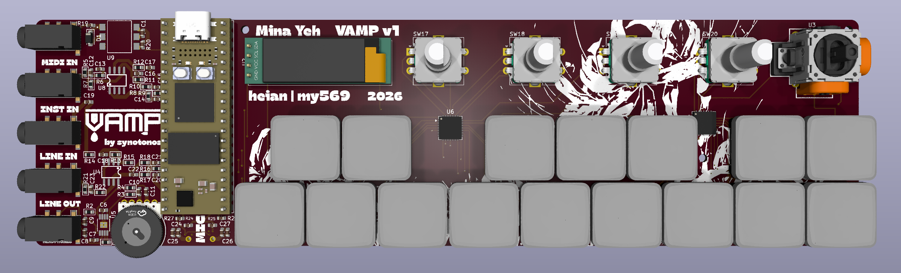
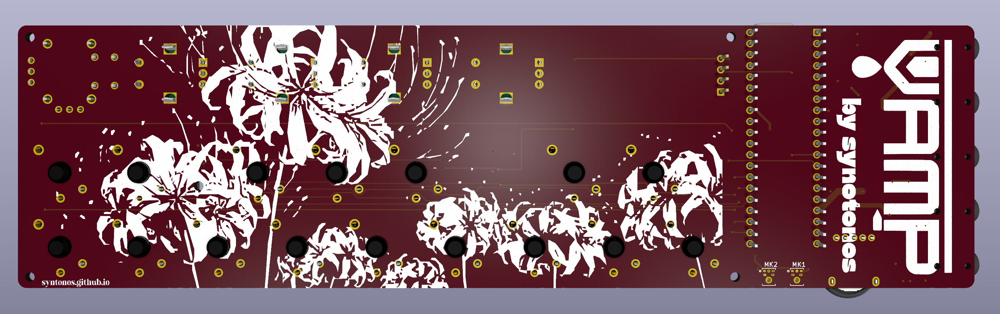
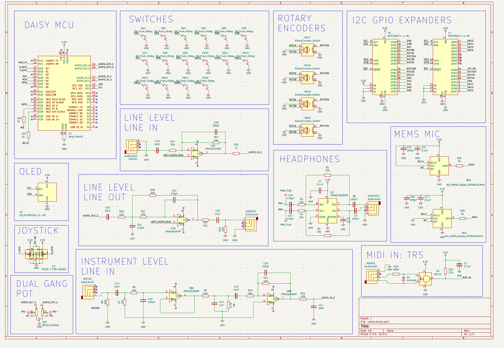
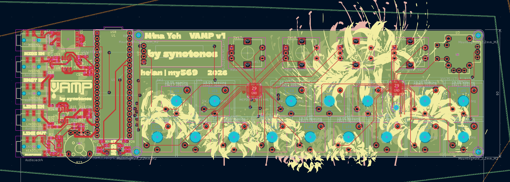
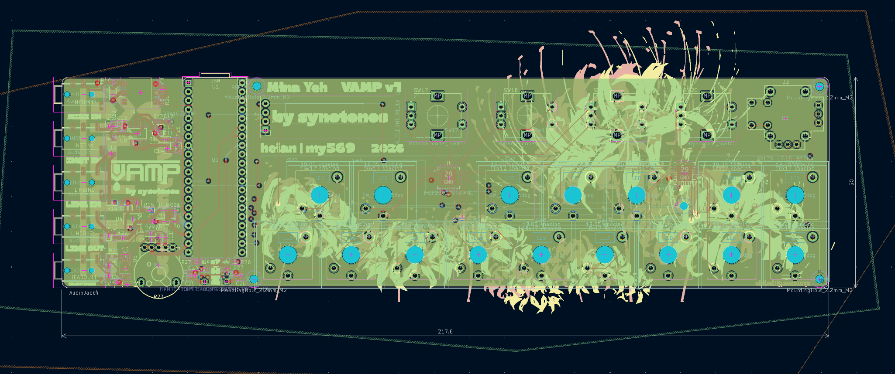
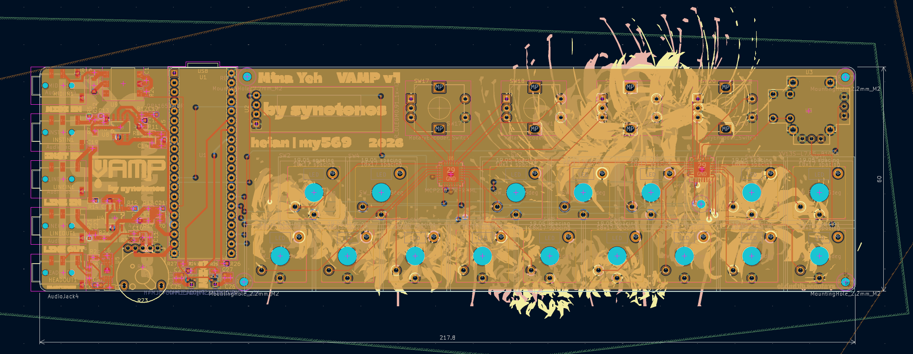
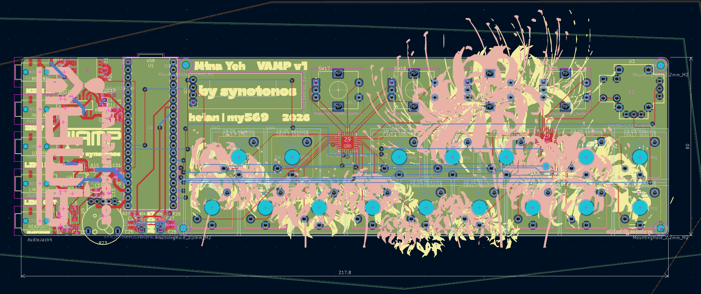

# VAMP | by synotonos

## Features
- 8-note keyboard + 4 layers to toggle through.
- 4 rotary encoders + an analog joystick for sound modulation. 
- 0.91" OLED display.
- Five 3.5mm TRS ports: MIDI IN, INSTRUMENT IN, LINE IN, LINE OUT, USB-C Power + Data.
- 3.5mm headphone jack. 
- Onboard omnidirectional stereo microphone with additional LINE IN options.
- Up to ten minutes of sampling time with the Daisy Seed. 
- USB-C 5V 1A power. 

## Origin

This whole set of synths is mostly because I do want to make music, and I want an instrument that works for me. I'm also very interested in digital signal processing, and this teaches both. 

## Assembly Instructions + Flashing Firmware

### Soldering

## PCB
### 3D Models

### Schematic

### PCB Layout

## Firmware
Firmware coded with C++ and Daisy Seed libraries (libDaisy). New features added as written! Flash through prefered IDE. 

## BOM
- 1x PCB + PCBA (topside)
- 1x Daisy Seed 3
- 1x 0.91" OLED Display Module
- 4x Rotary Encoders EC11 15mm Half
- 4x Rotary Encoder Caps (White for default)
- 16x Kaihl Choc V2 Low Profile Switches (Deep Sea Whale for default)
- 16x 3D Printed Keycaps (Choc Spacing)

## BOM Expanded
- 1x PCB + PCBA (topside)
    - $189.61 + tariffs ([JLCPCB](https://jlcpcb.com/))
- 1x Daisy Seed 3
    - $29.99 
- 1x OLED
    - $6.88 [Amazon](https://www.amazon.com/Screen-128x32-Display-SSD1306-Arduino/dp/B0DZGLN4FK?sr=8-4)
- 4x Rotary Encoders EC11 15mm Half

- 4x Rotary Encoder Caps (White for default)
    - 
- 16x Kaihl Choc V2 Low Profile Switches (Deep Sea Whale for default)
    - $29.90 [Amazon](https://www.amazon.com/Deep-Sea-Switches-Mechanical-Keyboard/dp/B0F8NLZQQD?sr=8-5)
- 16x 3D Printed Keycaps (Choc Spacing)
    - $depends
- 1x 3D Printed 
    - $depends